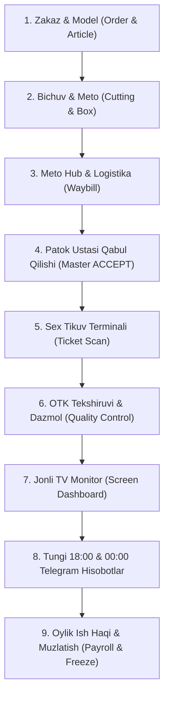
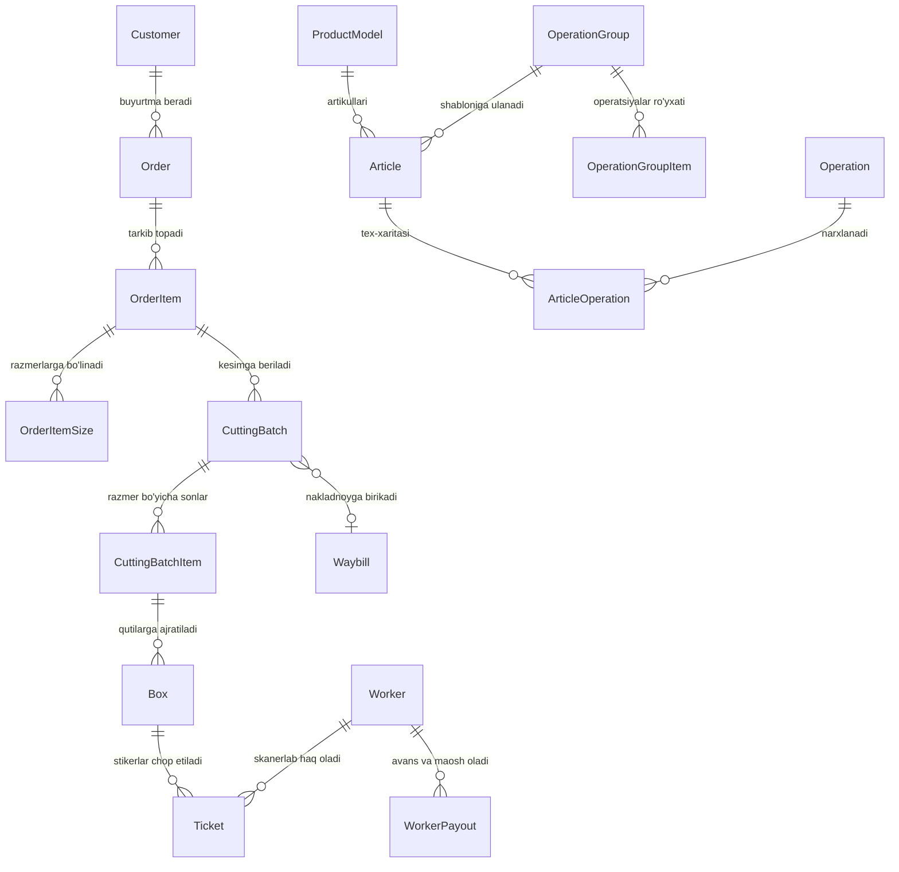

# TERRY JAR — Tikuvchilik Fabrikasi ERP & Ishbay Oylik Tizimi (Payroll)
## To'liq Texnik, Arxitektura va Biznes Jarayonlari Qo'llanmasi (Master Specification)

---

## MUNDARIJA
1. [Loyiha Haqida Umumiy Ma'lumot va Maqsad](#1-loyiha-haqida-umumiy-malumot-va-maqsad)
2. [Tizim Rollari va Huquqlar Tizimi](#2-tizim-rollari-va-huquqlar-tizimi)
3. [Ishlab Chiqarish Zanjiri (A dan Z gacha To'liq Jarayon)](#3-ishlab-chiqarish-zanjiri-a-dan-z-gacha-toliq-jarayon)
   - [1-bosqich: Zakaz, Model va Tex-xarita](#1-bosqich-zakaz-model-va-tex-xarita)
   - [2-bosqich: Bichuv (Kesim) va Meto (Nomerovka)](#2-bosqich-bichuv-kesim-va-meto-nomerovka)
   - [3-bosqich: Meto Hub va Filiallararo Logistika (Waybill)](#3-bosqich-meto-hub-va-filiallararo-logistika-waybill)
   - [4-bosqich: Master (Patok Ustasi) Qabul Qilishi](#4-bosqich-master-patok-ustasi-qabul-qilishi)
   - [5-bosqich: Sex Terminallari va Chevarlar Ishbay Hisobi](#5-bosqich-sex-terminallari-va-chevarlar-ishbay-hisobi)
   - [6-bosqich: Sifat Nazorati (OTK / Kontrol) va Dazmol](#6-bosqich-sifat-nazorati-otk-kontrol-va-dazmol)
   - [7-bosqich: Jonli TV Ekran Monitorlari (Screen Monitoring)](#7-bosqich-jonli-tv-ekran-monitorlari-screen-monitoring)
   - [8-bosqich: Tungi Avtomatik Hisobotlar va Baza Backup](#8-bosqich-tungi-avtomatik-hisobotlar-va-baza-backup)
   - [9-bosqich: Oylik Hisob-Kitob, Avanslar va Muzlatish (Freeze System)](#9-bosqich-oylik-hisob-kitob-avanslar-va-muzlatish-freeze-system)
4. [Tizimning 10 Oltin Qoidasi (Fundamental Qoidalar)](#4-tizimning-10-oltin-qoidasi-fundamental-qoidalar)
5. [Ma'lumotlar Bazasi Arxitekturasi va Modellar Aloqasi](#5-malumotlar-bazasi-arxitekturasi-va-modellar-aloqasi)
6. [Texnologiyalar Steki va Infratuzilma](#6-texnologiyalar-steki-va-infratuzilma)
7. [Yangi Dasturchi Uchun Loyihani Ishga Tushirish Yo'riqnomasi](#7-yangi-dasturchi-uchun-loyihani-ishga-tushirish-yoriqnomasi)

---

## 1. Loyiha Haqida Umumiy Ma'lumot va Maqsad

**TERRY JAR Payroll** — bu yirik to'qimachilik va tikuvchilik fabrikalari (hozirda **Kosonsoy Bosh binosi (13 ta patok)** va **Uychi filiali (21 ta patok)**, jami **40 tagacha patok**, **800+ chevar**, **250 000+ oylik stikerlar**) uchun maxsus yaratilgan **ishbay (sdelshina) ish haqi hisoblash va ishlab chiqarishni real vaqtda boshqarish ERP tizimi**.

### Asosiy Muammo va Yechim:
* **Eski muammo:** Chevarlar qancha tikkanini daftarga yozishi, oylik hisoblashda 1-2 hafta vaqt ketishi, stikerlar yo'qolishi, qaysi patokda qancha mahsulot borligi bilinmasligi va hisob-kitobdagi insoniy xatolar.
* **Tizim yechimi:** 
  1. Har bir kesilgan detal qutisiga **noyob shtrix-kodli stikerlar** yopishtiriladi.
  2. Chevar har bir operatsiyani bajargach, sexdagi planshet/terminalga kelib o'z nishonini (QR badge) va stikerni skanerlaydi.
  3. Tizim soniyaning ulushlarida chevarga haq yozadi, sex monitorlarida patok quvvatini ko'rsatadi va 18:00 hamda 00:00 da rahbariyat Telegram guruhiga to'liq hisobotlarni jo'natadi.

---

## 2. Tizim Rollari va Huquqlar Tizimi

Tizimda foydalanuvchilar (`accounts.User`) qat'iy rollarga bo'lingan:

| Rol kodi | Rol nomi | Mas'uliyati va Huquqlari |
|---|---|---|
| `SUPERADMIN` | Bosh Administrator | Tizimning to'liq boshqaruvi: narxlar matritsasi, barcha hisobotlar, xodimlar maoshi, oylikni muzlatish/yopish, sozlamalar. |
| `MANAGER` | Boshqaruvchi / Direktor | Ishlab chiqarish tahlili, kunlik va oylik hisobotlar, patoklar monitoringi, narxlarni ko'rish. |
| `BRANCH_ADMIN` | Filial Admini (Uychi) | Faqat o'z filialiga tegishli patoklar (14..40), qabul qilingan pastallar va nazoratni boshqarish. |
| `MASTER` | Patok Ustasi | Planshet orqali Metodan kelgan pastallarni qabul qilish (`ACCEPTED`), patok chevarlarini nazorat qilish. |
| `QUALITY_CONTROL` | OTK (Sifat Nazoratchisi) | 1-nav, 2-nav, nuqson (brak/remont) mahsulotlarni qutima-quti tekshirish, Dazmol stikerlarini tasdiqlash. |
| `METO_WORKER` | Bichuv / Metochi | Kesim partiyasi (pastal) sonlarini kiritish, qutilarni shakllantirish, stikerlarni chop etish, nakladnoy chiqarish. |
| `TERMINAL_USER` | Sex Terminali | Sexdagi skanerlash nuqtasi (faqat chevarlar stiker skanerlashi uchun ochiq turadi). |
| `EKRAN_USER` | Katta TV Ekran | Sex devoridagi monitor (faqat jonli patok grafigi va chevarlar reytingini ko'rsatadi). |

---

## 3. Ishlab Chiqarish Zanjiri (A dan Z gacha To'liq Jarayon)



### 1-bosqich: Zakaz, Model va Tex-xarita
1. **Zakaz (`Order`):** Mijoz buyurtmasi kiritiladi (masalan: `ORD-2026-10`, 10 000 dona).
2. **Model va Artikul (`ProductModel`, `Article`):** Mahsulot turi (masalan: *DC Belbog'li Xalat*, *Tunika DC*, *Ashan Mayka*).
3. **Razmerlar (`OrderItemSize`):** Buyurtma razmerlarga ajratiladi (S, M, L, XL, XXL). Har bir razmerning reja soni belgilanadi.
4. **Texnologik Xarita / Narxlar Matritsasi (`ArticleOperation`):**
   - Modelni tikish uchun bajariladigan barcha operatsiyalar ketma-ketligi (`sequence`).
   - Har bir operatsiyaning **1 dona uchun narxi (UZS)** (masalan: *Yoqa qadash — 350 so'm*, *Yeng ulash — 280 so'm*).
   - Har bir operatsiyaning **qiyinlik koeffitsiyenti (`difficulty`)** (Aniqlik / Operatsionka yig'indisi uchun).
   - Har bir modelning **kunlik normasi (`daily_norm`)** (masalan: 1 000 dona).
5. **Narxlar Shablonlari (`OperationGroup`):**
   - O'xshash mahsulotlar yagona narx shabloniga birlashtiriladi (masalan: *Futbolka shabloni*, *Xalat shabloni*).

---

### 2-bosqich: Bichuv (Kesim) va Meto (Nomerovka)
1. Bichuv sexida mato qatlamlanib kesiladi va **Pastal (`CuttingBatch`)** yaratiladi (masalan: `10-601`, 1 200 dona).
2. Har bir pastal razmerlar bo'yicha **Qutilarga (`Box`)** ajratiladi:
   - Masalan: 1-quti: 40 dona (L), 2-quti: 40 dona (L)...
   - Har bir qutiga noyob `box_code` (masalan: `BX-10-601-001`) beriladi.
3. **Stikerlar / Biletlar Generatsiyasi (`Ticket`):**
   - Qutidagi har bir operatsiya uchun bittadan stiker generatsiya qilinadi.
   - Masalan: Qutida 40 dona mahsulot va modelda 15 ta operatsiya bo'lsa -> Ushbu quti uchun 15 ta stiker yaratiladi.
   - Har bir stikerda: Quti raqami, Razmer, Soni (40 dona), Operatsiya nomi, Shtrix-kod / QR-kod aks etadi.
4. Chop etilgan stikerlar qutiga solinadi va tikuvga jo'natishga tayyorlanadi.

---

### 3-bosqich: Meto Hub va Filiallararo Logistika (Waybill)
Bichuvdan chiqqan pastallar darhol sexga tarqalmaydi, markaziy logistika tugunidan o'tadi:
1. **Kosonsoy Bosh binoga jo'natish:**
   - Meto xodimi pastalni tanlaydi va to'g'ridan-to'g'ri 1..13 patoklardan biriga biriktiradi (`assigned_screen=sn`).
   - Holati `DISPATCHED` (kutilmoqda) ga o'tadi.
2. **Uychi filialiga jo'natish:**
   - Bir nechta pastallar savatchaga yig'iladi va **Yo'l varaqasi / Nakladnoy (`Waybill`)** shakllantiriladi.
   - Mashinaga yuklanib, haydovchi orqali jo'natiladi.
   - Uychi filiali admini yukni sanab olgach, tizimda `RECEIVED` qiladi va Uychi patoklariga (14..34) taqsimlaydi.

---

### 4-bosqich: Master (Patok Ustasi) Qabul Qilishi
1. Har bir patok ustasi sexda o'z plansheti orqali tizimga kiradi (`/master/`).
2. Patokka yuborilgan pastallar ro'yxati chiqadi.
3. Master qutilar soni va matoni tekshirib, **«Qabul qilish» (`ACCEPTED`)** tugmasini bosadi.
4. **MUHIM:** Faqat master qabul qilgan (`ACCEPTED`) pastallargina ushbu patokning faol ishchi fondiga aylanadi.

---

### 5-bosqich: Sex Tikuv Terminali va Chevarlar Ishbay Hisobi
1. Chevar o'z operatsiyasini (masalan: 40 ta xalatning yengini ulab) tugatadi.
2. Qutidagi o'sha operatsiyaga tegishli stikerni olib, sex burchagidagi skaner terminaliga keladi.
3. **Skanerlash tartibi:**
   - 1-skan: O'zining ko'krak nishonidagi shaxsiy QR-kodi (masalan: `W-085`).
   - 2-skan: Bilet stikeri shtrix-kodi (masalan: `TK-312045`).
4. **Tizim xavfsizlik tekshiruvlari:**
   - Bilet oldin skanerlanganmi? (Dublikat bo'lsa darhol qizil signal va ogohlantirish beradi).
   - Quti yoki pastal bekor qilinganmi (`CANCELLED`)? Bekor qilingan bo'lsa to'xtatadi.
   - Chevar faolmi (`is_active=True`)?
5. **Natija:**
   - Chevar hisobiga soniyada pul yoziladi: `Jami = Soni x 1 dona narxi`.
   - Terminal ekranida chevarning ismi, topgan puli va rag'batlantiruvchi ovoz/signal chiqadi.

---

### 6-bosqich: Sifat Nazorati (OTK / Kontrol) va Dazmol
Mahsulot tikilib bo'lgach, sifat nazorati bo'limiga keladi:
1. **OTK Tekshiruvi:**
   - Nazoratchi qutini skanerlaydi.
   - Qutidagi mahsulotlarni sanaydi:
     - **1-nav (A'lo sifat):** Klientga ketadigan toza mahsulot.
     - **2-nav (Kichik kamchilik):** Narxi pasaytiriladigan mahsulot.
     - **Remont / Brak (Nuqson):** Qayta tikishga chevarga qaytariladigan qism.
   - Tekshiruv natijalari `BoxQualityInspectionLog` jadvaliga muhrlanadi.
2. **Dazmol (Tayyor Mahsulot):**
   - Dazmoldan o'tgan mahsulot biletlari skanerlanganda, ushbu buyum **«Fakt Tayyor Mahsulot»** deb hisoblanadi.
   - **Oraliq dazmollar** (tasma dazmol, cho'ntak dazmol) asosiy songa kirmaydi. Faqat **tayyor mahsulot dazmoli** olinadi.

---

### 7-bosqich: Jonli TV Ekran Monitorlari (Screen Monitoring)
Har bir patok tepasida katta TV monitor o'rnatilgan (`/screen/<patok_raqami>/`):
1. **Davomat:** Bugun ushbu patokda amalda stiker urgan faol chevarlar soni.
2. **Operatsionka (Aniqlik):** Ushbu patok tikayotgan modelning tex-xaritadagi operatsiyalari qiyinlik darajalari yig'indisi.
3. **Patok Quvvati (%):** 
   $$\text{Quvvat Foizi} = \frac{\text{Bugungi Jami Ishlangan Ish Haqi}}{\text{O'rtacha Kunlik Reja Summasi}} \times 100\%$$
   - Ranglar: Qizil (<60%), Sariq (60-85%), Yashil (85-100%), Moviy/Cyan (>100%).
4. **Reyting:** Chevarlarning bugungi bajargan normasi bo'yicha saralangan ro'yxati.

---

### 8-bosqich: Tungi Avtomatik Hisobotlar va Baza Backup
`run_scheduler` xizmati fonda 24/7 ishlab, quyidagi avtomatik ishlarni bajaradi:

1. **Soat 18:00 da (Toshkent vaqti bilan):**
   - Kosonsoy va Uychi guruhlariga alohida **Filial Kunlik Rasm-Hisobotlari (PNG format)** yuboriladi.
   - Unda: Patok №, Mahsulot & Dazmol (shablonlar kesimida), Davomat, Operatsionka, Quvvat foizi aks etadi.
2. **Soat 00:00 da (Toshkent vaqti bilan):**
   - **Kunlik hisobni yopish (`perform_daily_closing`):** Barcha chevarlarning bugungi daromadi hisoblanib, ularning balansi muhrlanadi.
   - **Oylik To'liq Excel hisoboti:** Oy boshidan to kechagi kungacha bo'lgan to'liq tabel yuboriladi.
   - **To'liq Baza Zaxirasi (Full DB Backup):** PostgreSQL bazasining to'liq `.sql.gz` fayli Telegramga tashlanadi.

---

### 9-bosqich: Oylik Hisob-Kitob, Avanslar va Muzlatish (Freeze System)
1. **Oylik Formulalari:**
   $$\text{To'lanishi Kerak Qoldiq} = (\text{Hisoblangan Ish Haqi} + \text{Bonus}) - \text{Avans} - \text{Magazin} - \text{Berilgan Oylik}$$
2. **Patoklar bo'yicha Oylik Tarqatish:**
   - Rahbariyat Excel hisobotini ochadi.
   - 4-ustundagi **«Patok»** filtri orqali kerakli patokni (masalan: `K1-Patok`) tanlaydi.
   - Faqat o'sha patok chevarlarini chaqirib pulini tarqatadi, qolgan patoklar ishdan to'xtamaydi.
3. **Oylikni Muzlatish (`Freeze System`):**
   - Oy yopilgach, Superadmin oylikni muzlatadi (`is_frozen=True`).
   - Muzlatilgan oydagi stikerlar va balanslar kelgusidagi narx o'zgarishlaridan qat'i nazar **butunlay daxlsiz qoladi**.

---

## 4. Tizimning 10 Oltin Qoidasi (Fundamental Qoidalar)

Dasturchi tizimni ishlab chiqishda yoki o'zgartirishda ushbu 10 ta oltin qoidani **hech qachon buzmasligi shart**:

1. **Oltin Qoida 1 — Narxlar Avto-Sinxronizatsiyasi:**
   Superadmin `/superadmin/pricing/` sahifasida operatsiya narxini o'zgartirsa, bazadagi barcha **muzlatilmagan (`is_frozen=False`)** stikerlar avtomatik yangi narx bo'yicha qayta hisoblanishi shart.
2. **Oltin Qoida 2 — Muzlatilgan Davr Daxlsizligi:**
   Muzlatilgan (`is_frozen=True`) biletlar va yopilgan oyliklar hech qanday narx o'zgarishi yoki qayta hisob-kitoblar ta'sirida o'zgarmasligi kerak.
3. **Oltin Qoida 3 — Skaner Transliteratsiyasini Taqiqlash:**
   Skaner klaviaturasi kirillchada bo'lsa, uni inglizchaga sun'iy tarjima qilish qat'iyan taqiqlanadi (chunki mahsulot nomlari va quti kodlari kirill harflarini o'z ichiga oladi, tarjima qilinganda buziladi).
4. **Oltin Qoida 4 — Patok Birikishi Ustuvorligi:**
   Dazmol va tikuv stikerlari qaysi patokka biriktirilgan pastaldan chiqqan bo'lsa (`assigned_screen`), o'sha patok hisobiga o'tadi. Boshqa patokda adashib skanerlangan qutilar begona patok ko'rsatkichini buzmasligi shart.
5. **Oltin Qoida 5 — Asosiy Dazmol Ajratilishi:**
   Katta hisobotlarda faqat tayyor kiyim dazmoli olinadi. Tasma yoki cho'ntak dazmollari mahsulot soni sifatida qo'shilmaydi.
6. **Oltin Qoida 6 — Shablonlar Yig'indisi Aniq Mosligi:**
   Hisobotda bir patokda bir nechta shablon tikilgan bo'lsa (masalan: Futbolka, Xalat, Xudi), har bir shablon soni alohida ko'rsatiladi va ularning yig'indisi patokning jami tayyor mahsulotiga **1 donasigacha aniq teng** bo'lishi shart. Nol (`0`) chiqqan shablonlar ko'rsatilmaydi.
7. **Oltin Qoida 7 — Oylik Tabelda Patok Ustuni:**
   Umumiy oylik Excel tabelida har bir chevarning oxirgi faol patogi ko'rsatiladi va Excelning AutoFilter imkoniyati yoqilgan bo'ladi.
8. **Oltin Qoida 8 — Xotira (Memory / OOM) Xavfsizligi:**
   Oylik hisobotlarda 250 000+ stikerlar openpyxl da katakma-katak aylanmasdan, PostgreSQL darajasida (`values().annotate()`) guruhlanib, xotira sarfi 300 MB dan oshmasligi ta'minlanishi shart.
9. **Oltin Qoida 9 — Qutilarni Yopish va Bekor Qilish Safeguards:**
   Bekor qilingan (`CANCELLED`) qutilarning stikerlari bekor qilinadi, ular skanerlanganda tizim xatolik qaytaradi va ish haqi yozmaydi.
10. **Oltin Qoida 10 — Avtomatlashtirilgan Tungi Zaxira:**
    Har kuni 00:00 da Toshkent vaqti bilan to'liq oylik hisobot va PostgreSQL ma'lumotlar bazasining to'liq siqilgan zaxira nusxasi (`.sql.gz`) Telegram guruhga jo'natilishi shart.

---

## 5. Ma'lumotlar Bazasi Arxitekturasi va Modellar Aloqasi



### Muhim Jadvallar Vazifasi:
* `accounts_user` / `accounts_worker`: Xodimlar, chevarlar, login parollar, QR nishonlar, balanslar.
* `production_order`: Asosiy buyurtmalar portfeli.
* `production_article`: Tikiladigan model artikuli va uning normasi.
* `production_articleoperation`: Operatsiyalar narxi va qiyinligi (eng muhim moliyaviy jadval).
* `production_cuttingbatch`: Bichuvdagi pastal partiyasi, holati (`DISPATCHED`, `ACCEPTED`) va biriktirilgan patok (`assigned_screen`).
* `production_box`: Quti (razmer, dona, pastal kodi, holati).
* `production_ticket`: Skanerlanadigan har bir individual stiker (skanerlangan vaqti, narxi, chevar ID, muzlatilganlik holati).
* `production_waybill`: Uychi filialiga jo'natiladigan yuk xati.
* `accounts_workerpayout`: Berilgan avanslar, naqd oyliklar, bonuslar va jarimalar.
* `production_dailypatokprogress`: Patokning har kungi yakuniy ko'rsatkichlari arxivi.

---

## 6. Texnologiyalar Steki va Infratuzilma

* **Backend:** Python 3.12 / 3.14, Django 5.x (Asinxron va Sinxron ORM).
* **Baza:** PostgreSQL 16 (Indekslangan, JSONB, Tranzaksiyalar darajasida xavfsiz).
* **WSGI / Server:** Gunicorn (`gthread` worker, 2 workers, 4 threads, timeout 120s).
* **Web Server & SSL:** Nginx (Reverse Proxy, Let's Encrypt SSL, Static cache).
* **Konteynerizatsiya:** Docker & Docker Compose:
  - `web`: Asosiy Django web ilovasi.
  - `db`: PostgreSQL ma'lumotlar bazasi.
  - `scheduler`: 18:00 va 00:00 dagi avtomatik hisobot va zaxirachi daemon.
  - `passport_bot`: Telegram Passport boti (OTK nazorati uchun).
  - `nginx`: Tashqi so'rovlarni qabul qiluvchi shlyuz.
* **Hisobot va Generatsiya:** Openpyxl (Excel hisobotlari), Pillow (PNG rasm generatsiyasi), KaTeX (LaTeX formulalar).
* **Frontend:** TailwindCSS, FontAwesome, HTML5, Vanilla JavaScript (Hech qanday og'ir React/Vue freymvorklarsiz — sababi sex terminallari va planshetlar maksimal tez yuklanishi kerak).

---

## 7. Yangi Dasturchi Uchun Loyihani Ishga Tushirish Yo'riqnomasi

### 1-qadam: Loyihani olish va muhitni sozlash
```bash
git clone git@github.com:ibrohimjonrahmonov28/PAYROLL.git
cd PAYROLL
cp .env.example .env # yoki mavjud .env ni sozlash
```

### 2-qadam: Muhit o'zgaruvchilari (`.env`)
```ini
DEBUG=False
SECRET_KEY=maxfiy_kalit
DB_ENGINE=django.db.backends.postgresql
DB_NAME=payroll_db
DB_USER=payroll_user
DB_PASSWORD=parol
DB_HOST=db
DB_PORT=5432
BOT_TOKEN=telegram_bot_token
TELEGRAM_REPORT_CHAT_ID=-1004374345556
TELEGRAM_HQ_REPORT_CHAT_ID=-1004425170756
TELEGRAM_UYCHI_REPORT_CHAT_ID=-1003903019133
```

### 3-qadam: Docker orqali ishga tushirish
```bash
# Barcha konteynerlarni yig'ish va ko'tarish
docker compose up -d --build

# Baza holatini tekshirish
docker compose exec web python manage.py showmigrations

# Bosh administrator yaratish
docker compose exec web python manage.py createsuperuser
```

### 4-qadam: Testlarni yurgazish
```bash
docker compose exec web python manage.py test production.tests
```

### 5-qadam: Serverda yangilanishlarni qo'llash (Production Deploy)
Har gal yangi funksiya GitHub'ga yuklanganda:
```bash
cd ~/PAYROLL
git pull origin main
docker compose restart web scheduler passport_bot
```
